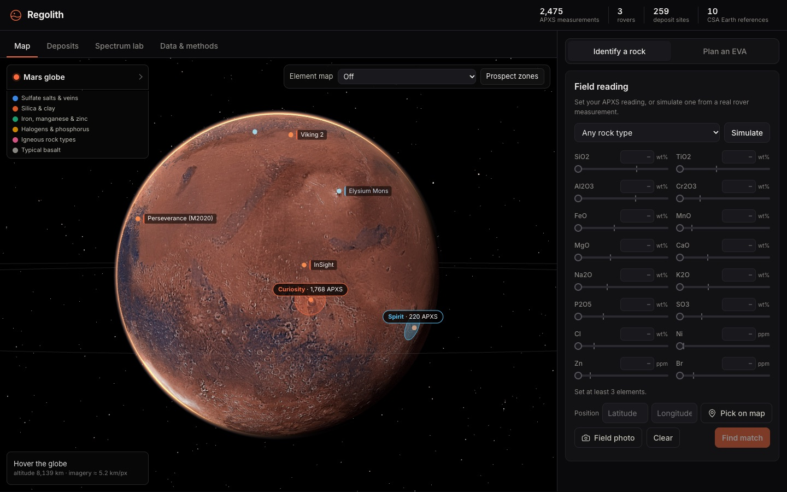

# Regolith

**NASA Space Apps Challenge 2026 · Interplanetary Survival Guide: Martian Map**

Regolith helps future Mars astronauts decide which rocks to sample and where to find resources. It matches
a field reading against all 2,475 APXS measurements made by Curiosity, Spirit and Opportunity, maps likely salt
and water from orbit, and plans a safe walking route over real terrain. Built only from NASA and Canadian Space
Agency data; Curiosity's APXS is Canada's instrument.



## Run it

```bash
cd regolith
python3 -m venv .venv && source .venv/bin/activate      # Windows: .venv\Scripts\activate
pip install -r backend/requirements.txt
cd backend && uvicorn app:app
```

Open http://127.0.0.1:8000. The data is included, so nothing else needs downloading. The map imagery
streams from NASA Mars Trek, so an internet connection is needed for the globe.

## Features

- **Identify a rock:** match an APXS reading against every rover measurement and get a sample / maybe / duplicate verdict
- **Prospect zones:** likely salt basins, water-rich and potassium-rich ground from Mars Odyssey and MOLA
- **Element maps:** where chlorine, iron, water and more are highest, from orbit and from rover rocks
- **Plan an EVA:** a slope-safe round trip over NASA's HiRISE terrain of Gale crater
- **Spectrum lab:** match a raw APXS X-ray spectrum against 1,760 Curiosity spectra and CSA lab standards
- **Data & methods:** every source and the accuracy tests behind each result

## More

- [Full documentation, data sources and measured accuracy](regolith/README.md)
- [4-minute demo script](regolith/docs/DEMO.md)

## Licence

Code: [MIT](LICENSE). Data: NASA (public domain) and Canadian Space Agency (Open Government Licence - Canada).
