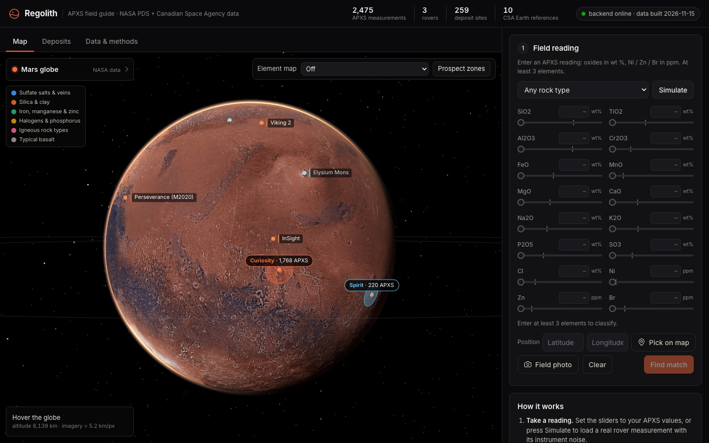
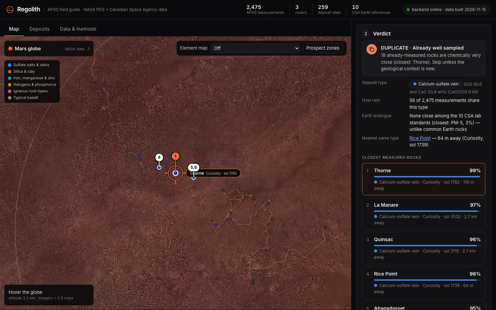
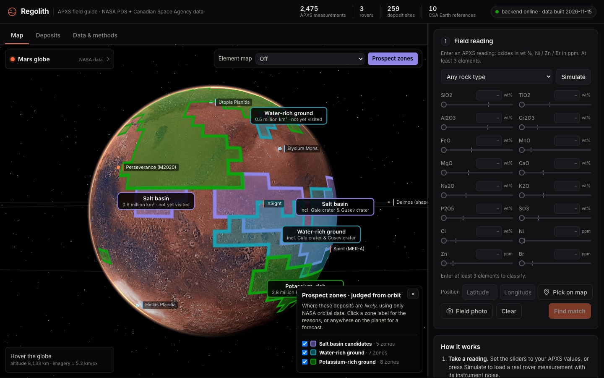
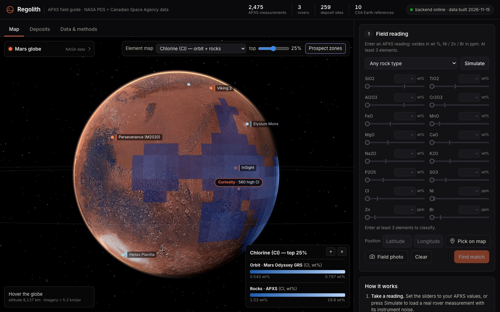
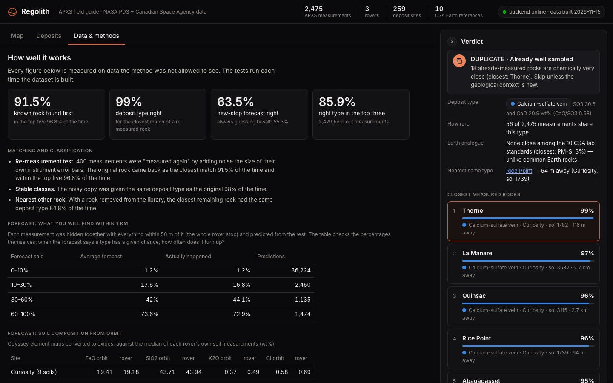

# Regolith

**An APXS field guide for Mars astronauts.** An astronaut takes an APXS reading of a rock (or simulates one),
and Regolith compares it against **all 2,475 APXS measurements** made by Curiosity, Spirit and Opportunity. It then:

- names the closest measured rocks, how similar they are, and how far away they are from you;
- classifies the deposit type (calcium-sulfate vein, opaline silica, manganese enrichment and so on);
- gives a **SAMPLE / MAYBE / DUPLICATE** verdict, weighing how new and how rare the chemistry is;
- shows the real rover close-up photos, the APXS X-ray spectrum and a chemistry chart for each rock;
- explains the likely reason for unusual chemistry, with links to the NASA/JPL pages about that rock type or region;
- maps everything on a 3D Mars globe sharpened with HiRISE imagery (0.3 m per pixel) at the rover sites;
- has **element concentration maps**: choose an element (for example chlorine) to highlight in blue where it is
  highest, from orbit (Mars Odyssey Gamma Ray Spectrometer, whole planet) and on the ground (APXS hotspots);
- has **prospect zones**: big, labelled areas on the full planet where salt basins, water-rich ground or
  potassium-rich rock are likely, judged only from NASA orbital data, each with the reasons, the numbers and
  what the rovers found there;
- makes **predictions**, each labelled as an estimate with its assumptions: the minerals a reading likely
  contains, what you would likely find within 1 km, the water you could extract per tonne of soil, and the
  soil an APXS would likely read anywhere on Mars;
- **shows its own accuracy**: hold-out tests run with every data build and appear in the Data & methods tab.

Regolith uses **only NASA and Canadian Space Agency data**. Curiosity's APXS is Canada's contribution to that
mission, and Regolith uses CSA Open Data directly (the Curiosity APXS archive and the instrument's pre-launch
calibration standards), alongside NASA PDS data. Spirit and Opportunity carried an earlier APXS; their data
comes from NASA's PDS.



| | |
|---|---|
|  |  |
|  |  |

## Measured accuracy

Each figure is measured on data the method was not allowed to see (`backend/rockmatch/validate.py`):

| Test | Result |
|---|---|
| A known rock, "measured again" with its own instrument error bars, is the closest match | 91.5% (in the top five: 96.8%) |
| The closest match of a re-measured rock has the right deposit type | 99.0% |
| The noisy copy is given the same deposit type as the original | 98.0% |
| With a rock removed, the closest remaining rock has the same deposit type | 84.8% |
| "Within 1 km" forecast at a rover stop it has never seen: top prediction right | 63.5% (always guessing basalt: 55.3%) |
| Same forecast: right type in the top three | 85.9% |
| Forecast percentages are honest: types given a 30–60% chance (average 42.0%) turned up | 44.1% of the time |
| Soil composition predicted from orbit against rover soils at three sites, largest miss | SiO2 8%, Cl 16%, K2O 24%, FeO 26% |

## Quick start

```bash
cd regolith
python3 -m venv .venv && source .venv/bin/activate      # Windows: .venv\Scripts\activate
pip install -r backend/requirements.txt
cd backend && uvicorn app:app --reload
```

Open **http://127.0.0.1:8000**. The built dataset is already in `backend/data/`, so the app works
straight after cloning.

To try it, choose a deposit type under **1 · Field reading**, press **Simulate**, then **Find match**.
Simulate fills the form with a real measurement plus its instrument error bars and places you
100–400 m from it. Regolith should find the source rock.

### Rebuild the dataset from the original sources (optional)

```bash
python backend/scripts/fetch_data.py      # downloads ~52 MB (3,734 files) into backend/data/raw/ - resumable
python backend/scripts/build_dataset.py   # parses, places on the map, classifies -> backend/data/*.json
```

`fetch_data.py --no-spectra` skips the X-ray spectra (~5 MB instead of ~52 MB). Spectra that aren't downloaded
are fetched once on demand and cached. `fetch_data.py --only grs` downloads just the Mars Odyssey GRS element maps, and `--only mola` the MOLA
elevation tiles used by the prospect zones.

### Tests

```bash
pip install -r backend/requirements-dev.txt
cd backend && python -m pytest -q          # 64 tests: classification, matching, element maps, predictions, hold-out results, API
```

## What's in the repo

```
backend/
  app.py                    FastAPI server: API, tile proxy, serves the two web pages
  rockmatch/                chemistry rules, matching, element maps, prospect zones, predictions, hold-out tests,
                            data sources, "why" context, geometry, spectra, photos
  scripts/fetch_data.py     downloads every raw dataset (NASA PDS, CSA, JPL, WUSTL)
  scripts/build_dataset.py  builds the JSON datasets + prints a validation report
  data/apxs_rocks.json      2,475 measurements: chemistry ± errors, quality, location, deposit class, provenance
  data/deposits.json        259 deposit sites (same-class measurements within 250 m)
  data/traverses.json       rover paths
  data/earth_refs.json      10 CSA lab calibration standards (Earth reference rocks)
  data/grs_maps.json        Mars Odyssey GRS element maps (Cl, Fe, Si, K, Th, H2O; 5° cells)
  data/prospects.json       prospect zones (orbit-only rules) with ground truth from the rovers
  data/validation.json      hold-out test results for matching and predictions
  data/raw/                 downloaded source files (git-ignored)
  tests/                    pytest suite
frontend/                   Regolith web app (map, deposits explorer, data & methods, charts)
docs/                       screenshots
mars-globe/                 3D Mars globe; embedded in Regolith and also works standalone
```

## Data sources

| Dataset | Provider | Used for | Licence |
|---|---|---|---|
| [MSL APXS RDR bundle](https://pds-geosciences.wustl.edu/msl/msl-m-apxs-4_5-rdr-v1/) — concentration tables, `*rwp*.csv` oxides, `*rsp*.csv` spectra | NASA PDS Geosciences Node | Curiosity chemistry (1,768 measurements), spectra | Public domain |
| [MER APXS oxide bundle](https://pds-geosciences.wustl.edu/mer/mer1_mer2-m-apxs-5-oxide-sci-v1/) (`mer_apxs_oxide.zip`) | NASA PDS Geosciences Node | Spirit (220) and Opportunity (487) chemistry | Public domain |
| [APXS on board the Curiosity rover](https://data.asc-csa.gc.ca/en/dataset/4596426-1c8f-3l9j-895mmct858mg42) | **Canadian Space Agency Open Data** | Curiosity RDR files for sols 46–1645 (430 measurements), 10 lab calibration standards (Earth references and their spectra) | Open Government Licence – Canada |
| [Curiosity waypoints](https://mars.nasa.gov/mmgis-maps/MSL/Layers/json/MSL_waypoints.json) | NASA/JPL-Caltech MMGIS | Where each Curiosity measurement was taken | NASA public data |
| [MER corrected traverses](https://an.rsl.wustl.edu/mera/AN/pages/mer/mer_traverse.htm) | PDS Analyst's Notebook (WUSTL), T. Parker | Where each Spirit and Opportunity measurement was taken | NASA PDS |
| Raw images API, PDS Imaging Node | NASA/JPL-Caltech/MSSS, NASA/JPL/Cornell/USGS | MAHLI and Microscopic Imager close-ups | NASA public data |
| [NASA Mars Trek](https://trek.nasa.gov/mars/) tiles: Viking MDIM 2.1, MGS MOLA, Odyssey THEMIS, MRO HiRISE, Viking Phobos mosaic | NASA/JPL-Caltech, USGS, ASU, UArizona | Globe imagery and elevation | NASA public data |
| [Mars Odyssey GRS element maps](https://pds-geosciences.wustl.edu/ody/ody-m-grs-5-elements-v1/) (`ODY-M-GRS-5-ELEMENTS-V1.0`, smoothed 5°×5°) | NASA PDS Geosciences Node; Boynton et al. (2007), JGR 112, E12S99 | Orbital element concentration maps: Cl, Fe, Si, K, Th, water-equivalent hydrogen | Public domain |
| [MGS MOLA elevation](https://trek.nasa.gov/mars/) (`Mars_MGS_MOLA_DEM_mosaic_global_463m_8`, zoom 2) | NASA Mars Trek | Mean elevation of every 5° cell for the prospect zones (checked: Curiosity and Spirit landing sites within 30 m) | NASA public data |
| NASA/JPL news releases and mission pages | NASA/JPL-Caltech | "Why" links for each deposit type (for example the 2011 gypsum vein and 2022 salty-region releases) | NASA public data |
| NASA Mars Trek layer "MRO CTX Mosaic Global" (`CTX_beta01_uncontrolled_5m_Caltech`) | NASA/JPL/MSSS (MRO CTX images), mosaic by Caltech. Tiles come from the server Trek's own capabilities file points to | Globe imagery (streamed at up to ~10 m/px) | NASA public data, credit required |

| [Curiosity SAM soil-water result](https://www.nasa.gov/solar-system/curiositys-sam-instrument-finds-water-and-more-in-surface-sample/) | NASA (Leshin et al. 2013) | The one published constant in the predictions: about 2 wt% water released when Gale soil was heated to 835 °C | NASA public information |

No other data is used. Code libraries (three.js), the Inter typeface and line icons carry no data.
`backend/data/raw/MANIFEST.json` records every download (URL, licence, counts, date), and the app's
Data & methods tab lists every source with what was loaded from it (`/api/sources`).

One judgement call: the CTX mosaic is made of NASA MRO images and is a NASA Mars Trek layer, but it was assembled
by Caltech's Murray Lab and its tiles are served from the address Trek lists for it. It only sharpens the map
imagery; nothing is computed from it.

## How it works

- **Where:** each Curiosity measurement is placed at the rover's position at the start of that sol
  (JPL waypoints). Spirit and Opportunity measurements use the PDS-corrected traverses. Positions are
  typically good to within one sol's drive (~100 m). The build checks all three landing sites against their
  published coordinates (within 0.2 km).
- **Linking files:** each Curiosity table row is linked to its own `rwp`/`rsp` file by spacecraft clock and verified
  by chemistry (agreement 0.03 wt% on average, 1,760 of 1,768 linked).
- **Deposit classes:** a transparent rule set over bulk chemistry (`backend/rockmatch/chemistry.py`), for
  example Ca-sulfate veins (SO3 ≥ 18 and CaO ≥ 12 wt% at a CaSO4-like ratio) or opaline silica (SiO2 ≥ 65 wt%).
  This is a screening of chemistry, not a mineral identification. Each rock records the values that triggered
  its class.
- **Matching:** each element is standardised by its spread across all measurements. Trace metals are compared
  on a log scale. The distance is converted to a similarity percentage.
- **Element maps:** choose an element and a cut-off (top 1–50 %). Each dataset is ranked on its own:
  - **Orbit:** Odyssey GRS 5° cells at or above that percentile are shaded blue, brighter for higher values,
    drawn as NASA's exact cells. Hovering shows the cell's value and NASA's 1σ error (SIGMA WITH CFS, or SIGMA
    for K and Th, where no correction factors apply). Longitudes are east-positive, checked against NASA's own
    browse maps.
  - **Ground:** APXS measurements at or above the APXS percentile turn blue. Those within 500 m of each other
    form a hotspot, drawn as a white ring at its true size and ranked by its highest value.
  - **Rover sites:** the panel lists, for Gale, Gusev and Meridiani, the orbital value of the cell the rover is in
    (with its percentile) next to how many of the rover's own readings are high.

  GRS reports elements (Fe, Si, K) and APXS reports oxides (FeO, SiO2, K2O). The two are never mixed, and the
  panel gives the conversion factor. Sulfur, Mg, Ca, Al, Na, P, Mn, Ti, Cr, Ni, Zn and Br have APXS data only.
  Th and hydrogen have orbital data only.
- **Prospect zones:** three rules over NASA orbital data only, applied to NASA's 5° cells. Neighbouring cells
  join into one zone:
  - **Salt basin:** Odyssey chlorine in the top 15% and the cell lower than the planet's median elevation
    (MOLA). Salty water pools and evaporates in low ground.
  - **Water-rich ground:** Odyssey water-equivalent hydrogen in the top 15%.
  - **Potassium-rich ground:** Odyssey potassium in the top 15%. This marks candidates for alkali-rich igneous
    rock; potassium can also come from sediments, so it is a lead, not an identification.

  Rover data never draws a zone. It is shown afterwards as ground truth: Gale and Gusev fall in salt zones, where
  Curiosity recorded 103 halide-class readings, and Meridiani falls in a water zone, where Opportunity recorded
  167 sulfate-class readings.
- **Predictions (one step beyond the data):**
  - **Likely minerals:** upper-bound amounts of calcium phosphate, calcium sulfate, magnesium sulfate and halite, from
    the oxides and each mineral's formula (a normative calculation). Sulfur or chlorine that can't be matched is
    reported, for example possible elemental sulfur.
  - **What you'll find within 1 km:** rover measurements within 1 km of your position, closer ones counting
    more (300 m scale), smoothed towards the planet-wide mix. The weighting was chosen by a hold-out test (hide a
    measurement and its whole rover stop, predict it from the rest) and its measured accuracy is shown with every
    forecast. Only given where rovers measured, with a note that rovers chose unusual targets.
  - **Water you could extract:** Odyssey water-equivalent hydrogen as litres per tonne of soil (1 wt% = 10 L per
    tonne) gives an upper bound: 54 L at Gale. A practical figure assumes the same share is released as when
    Curiosity's SAM heated Gale soil to 835 °C: about 2 wt% water, 37% of Odyssey's 5.4 wt% there, so about 20 L
    ([NASA, 2013](https://www.nasa.gov/solar-system/curiositys-sam-instrument-finds-water-and-more-in-surface-sample/)).
  - **Soil from orbit:** Odyssey Fe, Si, K and Cl converted to FeO, SiO2, K2O and Cl. This was checked against the
    rovers' own soil measurements at Gale, Gusev and Meridiani; the largest misses (FeO 26%, SiO2 8%, K2O 24%,
    Cl 16%) are shown with every prediction.
- **Targeting a rock:** the selected rock gets a ring and crosshair, its name sits beside it, other rocks fade,
  and other labels are hidden up close. Numbered match pins stand on stems pointing at their exact spot; matches
  recorded at the same spot share one pin. Esc clears the selection.
- **Why this chemistry:** for each deposit class, a short explanation of how that chemistry forms. It also lists
  which elements are far above the median, and their usual causes. Each class links to the NASA/JPL release about
  that kind of deposit. These are likely explanations from bulk chemistry, not mineral identifications.
- **Colours:** every deposit type belongs to one of five families: sulfates (blue), silica & clay (orange),
  iron/manganese/zinc (aqua), halogens & phosphorus (yellow) and igneous (magenta). Typical basalt is grey.
  The map and the Deposits tab use the same colours. Each family view on the map uses at most three colours
  for its deposit types. The colours were checked for colour-blind readers with a palette validator, and they
  always appear next to their names (key, labels, hover).

## Known limits

- Opportunity's iron meteorites (Heat Shield Rock and others) aren't in NASA's MER oxide table, so they're not
  in the dataset. Curiosity's are.
- X-ray spectra are linked for Curiosity. MER spectra exist in PDS but aren't linked yet.
- Odyssey GRS values are 10° moving averages (~600 km across at the equator), rebinned on 5° cells, of roughly
  the top few tens of centimetres (Boynton et al. 2007). A blue cell means that region's average is high, not that
  every rock in it is. Rovers visited only three sites, so most blue cells have no rover data. NASA masks Cl, Fe,
  Si and hydrogen near the poles, where it cannot yet correct for water-ice dilution; the data stop between 40°
  and 60°N and between 45° and 60°S. K and Th are global.
- Photo-based identification isn't implemented. Field photos are stored with your notes, and identification
  uses the APXS chemistry.
